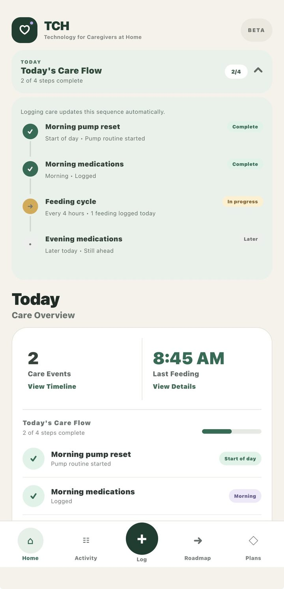
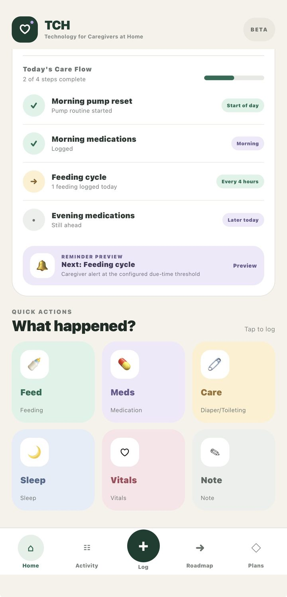
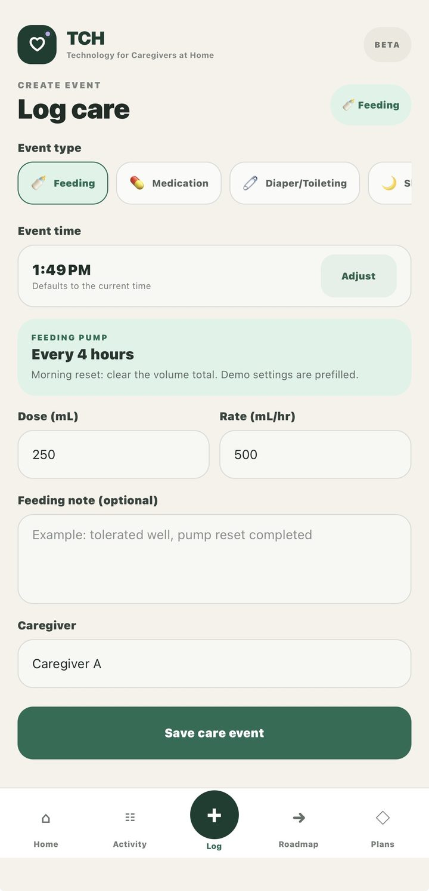
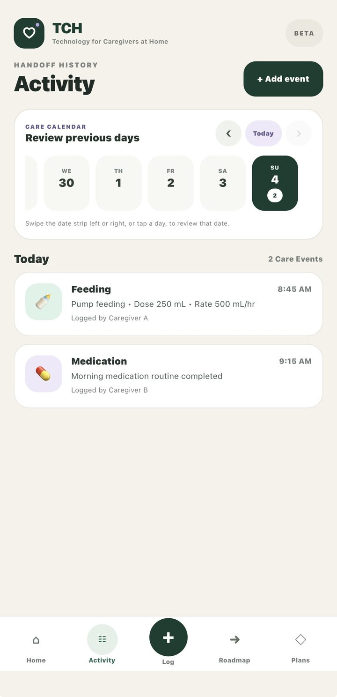
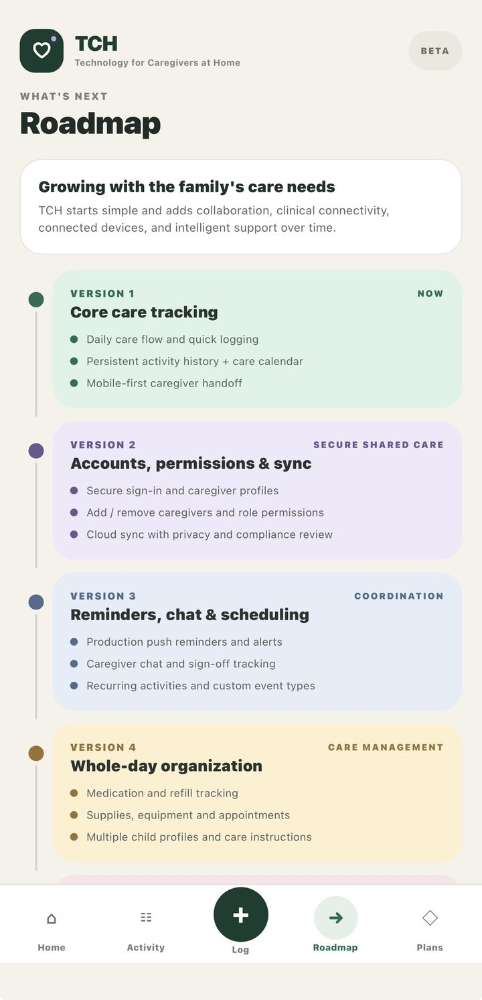

# TCH — Technology for Caregivers at Home

TCH is a **React Native / TypeScript caregiver-coordination prototype** originally built for WVU SENG 564 (Software Engineering of Mobile Applications). This repository is a portfolio-safe snapshot of that classroom MVP and the starting point for continued product engineering.

> **Current boundary:** TCH is a prototype. It is not a production healthcare system, does not claim HIPAA compliance, and does not currently provide production authentication, cloud synchronization, or live EHR integration.

## What the MVP demonstrates

- child-centered care dashboard and daily care-flow status
- structured logging for feeding, medication, diaper/toileting, sleep, vitals, and notes
- configurable event timestamps
- persistent local event history with `AsyncStorage`
- activity timeline and care-calendar views
- responsive phone/tablet layouts
- product roadmap and tier concepts for future releases

All data committed to this repository is **synthetic demonstration data**. Personal demo data and images from the classroom build are intentionally excluded.

## Screenshots

| Home care flow | Quick actions |
| --- | --- |
|  |  |

| Log care | Activity history |
| --- | --- |
|  |  |

### Product roadmap



## Tech stack

- React Native 0.86
- Expo SDK 57 / Expo Router
- TypeScript
- React 19
- AsyncStorage
- React Native Community DateTimePicker
- React Native Reanimated

## Run locally

Requirements: a current Node.js LTS release and npm. Expo Go or a simulator/emulator can be used for device testing.

```bash
npm install
npm start
```

Useful commands:

```bash
npm run android
npm run ios
npm run web
npm run typecheck
```

## Testing

Run the unit tests with one command:

```bash
npm test -- --runInBand
```

The Jest suite uses the `jest-expo` preset and covers date formatting, date shifting, legacy UTC-to-local date normalization, and the care-event persistence boundary. Date-normalization tests control the clock and simulate local calendar dates so they are independent of the machine's timezone. Persistence tests mock AsyncStorage and cover missing data, saved and empty event lists, serialization, malformed JSON, and storage read/write failures.

Run TypeScript checking separately with `npm run typecheck`. GitHub Actions runs both type-checking and `npm test -- --ci --runInBand` on pushes to `main` and pull requests targeting `main`.

## Current architecture

The classroom MVP intentionally optimized for shipping a working mobile prototype quickly. Most product behavior currently lives in `src/app/index.tsx`, including navigation state, care-event state, persistence, forms, calendar behavior, roadmap content, and styling.

That makes the current build easy to inspect as one artifact, but it is **not the target production architecture**. The next engineering phase is to split the prototype into smaller feature modules, reusable components, typed data/services, and testable state/persistence boundaries. See [`docs/ARCHITECTURE.md`](docs/ARCHITECTURE.md).

## Data and security boundary

The MVP stores care events locally using AsyncStorage. AsyncStorage should not be treated as a production secure-health-data store. Before any real shared-care use, the project needs authentication/authorization, a secure backend and data model, encryption and secrets management, auditability, retention/deletion controls, and privacy/security review.

See [`docs/SECURITY-PRIVACY.md`](docs/SECURITY-PRIVACY.md).

## Roadmap

Near-term engineering priorities:

1. modularize the current single-screen prototype
2. add component/service tests and stronger CI
3. create configurable onboarding and demo profiles
4. design authenticated shared-care data flow
5. add a secure cloud persistence layer only after the security model is defined
6. validate the product with a small closed beta before expanding scope

Later concepts shown in the prototype—such as EHR/FHIR integration, connected devices, and AI-assisted coordination—are roadmap ideas, not implemented production capabilities.

## Repository status

This repository begins with a **sanitized snapshot** of the completed SENG 564 prototype. Personal demo data/images and unused Expo starter-route assets were removed without changing the core care-tracking feature logic. The original academic ZIP remains unchanged outside this repository. Future changes will use issues, branches, pull requests, and CI so the Git history documents the engineering progression from classroom MVP to a maintainable product.

## Author

**Avery Holmes**  
M.S. Software Engineering candidate, West Virginia University
